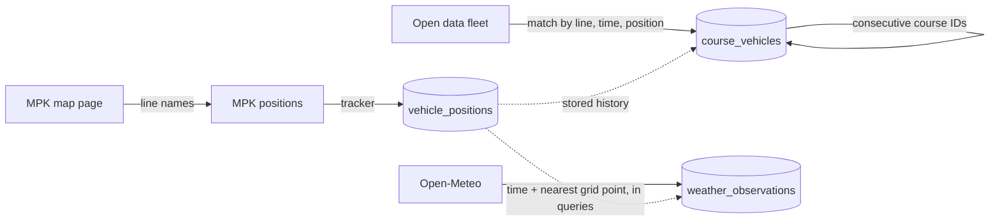

# External data sources

`mpk-history collect` reads four external sources. Three loops run side by side:
vehicle positions, weather and fleet data. This document describes how each source
is read, what its data looks like, and how the sources are linked to each other.
How the result is stored is described in [database.md](database.md).

| Source | URL | What it gives | Read every | Code |
|---|---|---|---|---|
| MPK map page | `https://mpk.wroc.pl/strefa-pasazera/zaplanuj-podroz/mapa-pozycji-pojazdow` | List of lines | 1 h (`--lines-refresh-secs`) | `src/mpk.rs` |
| MPK positions | `https://mpk.wroc.pl/bus_position` | Live positions of vehicles | 10 s (`--interval-secs`) | `src/mpk.rs`, `src/collector.rs` |
| Open-Meteo | `https://api.open-meteo.com/v1/forecast` | Weather on a grid over the city | 30 min (`--weather-interval-secs`) | `src/open_meteo.rs`, `src/weather.rs` |
| Wrocław open data | `https://open-data.cui.wroclaw.pl/hdb/db/14?download=json` | Side number, plate and brigade of each vehicle | 15 min (`--fleet-interval-secs`) | `src/open_data.rs`, `src/fleet.rs`, `src/inference.rs` |

All HTTP requests share one client with a 30 s timeout. A failed request only logs a
warning; the loop tries again at its next tick.

## MPK line list

The positions endpoint only returns vehicles of the lines you ask for, and there is no
endpoint that lists all lines. The list is taken from the HTML of the public map page:

```html
<div class="bus-gps-lines bus"><ul><li class="line">A</li><li class="line">100</li>…</ul></div>
<div class="bus-gps-lines tram"><ul><li class="line">0</li><li class="line">1</li>…</ul></div>
```

- Each `li.line` inside `.bus-gps-lines.bus`, `.bus-gps-lines.tram` and
  `.bus-gps-lines.train` is one line of that vehicle type. There is no train block on
  the page today, but the page's own JavaScript supports one, so it is read if it
  appears.
- Names are trimmed and lowercased (`A` becomes `a`), because that is how the
  positions endpoint returns them.
- If the page can't be read, the collector keeps using the list it already has in
  memory. Until it has a list, no positions are fetched.

## MPK vehicle positions

### Request

A `POST` with a form body that repeats one key per line:

```
busList[bus][]=a&busList[bus][]=100&…&busList[tram][]=0&busList[tram][]=1&…
```

The endpoint matches only on the line **name**. The type in the key is ignored: asking
for `busList[train][]=1` returns tram 1. So the vehicle type in the response comes from
the server, not from the request.

### Response

A JSON array with one object per vehicle:

```json
[{"name":"a","type":"bus","y":17.07566,"x":51.148666,"k":29073702}, …]
```

| Field | Meaning | Notes |
|---|---|---|
| `name` | Line name | Lowercase |
| `type` | `bus`, `tram` or `train` | Decided by the server |
| `x` | **Latitude** | Yes, `x` is latitude |
| `y` | **Longitude** | Yes, `y` is longitude |
| `k` | Course ID | One trip of one brigade, see [Course IDs](#course-ids) |

Things to know about this data:

- **No timestamps.** The time of a position is the time we fetched it.
- **Refresh rhythm.** The server updates all positions at once every 5 s. A single
  vehicle usually gets a new position every 15 s, sometimes every 5 or 10 s.
  Polling faster than every 5 s gains nothing.
- **Precision.** Most coordinates are 32-bit floats written out as decimals. Around
  Wrocław that is a step of about 42 cm north–south and 13 cm east–west. No value has
  more than 6 decimals.
- **Bad positions.** About 0.3% of positions are GPS junk: values outside ±90° / ±180°
  (often `7158.279` for both coordinates) or exactly `0, 0`. They are never stored
  (`geo::is_plausible_fix`), only counted as `invalid` in the log. Bad positions stored
  by early versions were deleted once, by migrations `0004` and `0006`.
- **Shared course IDs.** Sometimes two vehicles report the same line and course ID at
  the same time, at different positions. Both are stored, each in its own rows.
- **Unknown entries.** Entries that don't parse (for example an unknown vehicle type)
  are not stored. A warning is logged, and the rest of the fetch is stored as usual.

### From positions to rows

Storing every position of every fetch would repeat the same position many times:
about 60% of vehicles don't move between two 10-second fetches. So the collector keeps
one row per vehicle per position, with the time range it stayed there. The tracker in
`src/collector.rs` keeps the open row of every vehicle in memory
(key: type, line, course ID) and decides per fetch:

- **Extend the row** if all of these hold:
  - the vehicle is within `--min-move-meters` (default 2 m) of **where the row
    started**. Measuring from the start, not from the previous report, means slow
    creeping still adds up and starts a new row.
  - the row was last extended at most 3 intervals ago. If fetches fail for longer,
    the next successful fetch starts a new row, so a gap in collection is not hidden
    inside a row
  - the row is not older than 10 minutes. This limit keeps queries by time fast; see
    [database.md](database.md#vehicle_positions).
- **Start a new row** otherwise, and for vehicles seen for the first time.
- A vehicle missing from a successful fetch is removed from the tracker's memory. Its
  stored row stays as it is and simply ends at the last time the vehicle was seen. If
  the vehicle comes back, it gets a new row.
- If two vehicles share a key, each is matched to its own open row by position.
- Times are stored in whole seconds, so if a fetch is due in the same second as the
  last saved one, it is not made at all.

After a restart the tracker is empty, so the first fetch starts a new row for every
vehicle.

## Open-Meteo weather

### Request

```
GET https://api.open-meteo.com/v1/forecast
    ?current=temperature_2m,relative_humidity_2m,precipitation,rain,showers,snowfall,
             weather_code,cloud_cover,surface_pressure,wind_speed_10m,wind_direction_10m,wind_gusts_10m
    &bounding_box=51.014880,16.843681,51.198100,17.166088
    &models=icon_d2
    &timeformat=unixtime
    &forecast_days=1
```

- `bounding_box` is `south,west,north,east`. The default is the box of all vehicle
  positions seen so far (see `mpk-history bbox`). You can change it with
  `--weather-area`.
- `models=icon_d2` is the DWD ICON-D2 model, with a grid of about 2 km (0.02°). You can
  change it with `--weather-model`; the model must support bounding boxes.
- `timeformat=unixtime` makes `current.time` a UTC Unix time.

### Response

A JSON array with one object per grid point (144 points for the default box). If the
box contains only one point, the response is a single object; both shapes are handled.

```json
[{"latitude":51.02,"longitude":16.839998,
  "current":{"time":1790342100,"interval":900,"temperature_2m":14.8,"relative_humidity_2m":73,…}}, …]
```

- `current` values are **15-minute values** (`interval: 900`). `time` is the start of
  the 15-minute step.
- Units are the Open-Meteo defaults: °C, %, mm, cm for snowfall, WMO weather code, %,
  hPa, km/h, degrees.
- Any value can be `null` and is then stored as `NULL`.
- On an error, Open-Meteo returns `{"error": true, "reason": "…"}`. The reason is
  written to the log.

### Rate limit

The free tier allows 10,000 calls per day, 5,000 per hour and 600 per minute, and is
for non-commercial use only. A request costs
`number of locations × (days / 14) × (variables / 10)` calls. The default request has
144 locations and 12 variables, so it costs about 173 calls. At the default 30-minute
interval that is about 8,300 calls per day. At 15 minutes it would be about 16,600,
which is over the free limit. With a 30-minute interval, every second 15-minute value
is never downloaded, so it is missing from the database.

## Wrocław open data: fleet

Dataset *"Lokalizacja pojazdów komunikacji miejskiej na trasie"* (CC0 license). It is
the same GPS data as the MPK feed, but published later and with vehicle details.

### Request and response

A plain `GET` of the JSON download (about 300 KB):

```json
{"meta": {…},
 "dane": [{"Nr_Boczny": 8335, "Nr_Rej": "DW916KF", "Brygada": "00104", "Nazwa_Linii": "A",
           "Data_Aktualizacji": "2026-09-26T14:59:55.370000",
           "Ostatnia_Pozycja_Szerokosc": 51.146968841552734, "Ostatnia_Pozycja_Dlugosc": 17.02387046813965}, …]}
```

| Field | Meaning | Handling |
|---|---|---|
| `Nr_Boczny` | Side number of the vehicle | Always an integer. `0` means unknown, and the record is not used |
| `Nr_Rej` | Plate number | `null`, `"-"` and `""` mean no plate. Stored uppercase without spaces |
| `Brygada` | Brigade (duty) code | For example `12207` = line 122, brigade 07. Letter lines look like `D02` |
| `Nazwa_Linii` | Line name | `null` or `""` means not on a route, and the record is not used. Lowercased |
| `Data_Aktualizacji` | Time of the position | **Warsaw local time**, converted to UTC |
| `Ostatnia_Pozycja_Szerokosc` | Latitude | Records at `0, 0` or out of range are not used |
| `Ostatnia_Pozycja_Dlugosc` | Longitude | |

The fleet data itself is never stored. It is only used to find matches, and only the
matches are saved (see below).

Things to know about this data:

- There is one record per vehicle (about 970), not one per course.
- The data is about **15 minutes behind** and changes in batches, about every 15
  minutes. That's why it can't be compared with live positions, only with stored
  history.
- Many records are stale: vehicles that stopped reporting keep their last record for
  days.
- Only about 12% of records have a plate. Trams have none.
- The page's metadata is wrong: it says the data is updated hourly and uses the title
  of the timetable dataset.
- The "API link" shown on the page returns 404; the JSON download works.

## How the sources are linked



### Course IDs

The course ID (`k`) is the key that links everything. It identifies **one trip of one
brigade**. In the data so far, course IDs are unique across lines, and each brigade gets a block of
consecutive IDs for its trips of the day. For example, brigade 12204 of line 122 ran
courses `29114019`, `29114020` and `29114021`, all with bus 5413.

### Fleet record → course (direct match)

For each fleet record whose `Data_Aktualizacji` changed since the previous download
(`src/fleet.rs`). The collector remembers these times in memory, so after a restart
every record is checked once more:

1. Load all stored positions of the record's line that were active within **30 s** of
   the record's time.
2. Measure the distance from the record's position to each of them, keeping the
   nearest distance per course.
3. If exactly one course is within **20 m**, it is a match. The side number, plate and
   brigade are stored for that course, with the distance.
4. If two or more courses are within 20 m (for example two buses at a terminal), the
   record is counted as `ambiguous`. If none is, it is counted as `unmatched`. In both
   cases nothing is stored, and the record is not tried again until its
   `Data_Aktualizacji` changes in a later download.

This works because both sources carry the same GPS fix: most matches are closer than
1 m. In one test download, 211 of 324 fresh records matched, 8 were ambiguous, and no
side number was matched to two different courses.

### Course → neighbouring courses (inference)

Many courses are never matched directly, because each vehicle gets only one fleet
record every 15 minutes. `src/inference.rs` fills them from the brigade's previous or
next trip, using the consecutive course IDs. After each fleet download, over the last
6 hours:

- Course *N* and course *N+1* count as consecutive trips of one brigade if all of these
  hold:
  - they are on the same line
  - *N+1* starts at most **45 minutes** after *N* ends
    (`--fleet-inference-max-gap-secs`, default 2700), and not before *N* ends
  - *N+1* starts at most **500 m** from where *N* ended
    (`--fleet-inference-max-distance-meters`)
- A course without a vehicle takes the vehicle of such a neighbour, if that neighbour
  has exactly one vehicle. This repeats, so values spread along chains of trips.
- If the previous and the next trip point to different vehicles, the course between
  them gets no vehicle in this run. Nothing is deleted, and the neighbours keep their
  vehicles. The course is checked again after the next fleet download.
- A trip whose first stored row is in the first 10 minutes of the window can't take a
  vehicle from its **previous** trip in that run. It may have started before the
  window, so its real start is not visible. It can still take a vehicle from its next
  trip, and give its own vehicle to its next trip.
- Inferred values are stored with `source = 1` and the course they were copied from
  (`inferred_from_course_id`). `query` marks them with `*`.

Tested on 279 pairs of consecutive courses that were both matched directly, the rule
never linked two different buses on the same line. In the hours when fleet matching
ran, it raised the share of courses with a known vehicle from 69% to 85%.

**Corrections.** When a direct match arrives for a course that has an inferred
vehicle, the inferred row is deleted and the direct match is stored instead
(`propagate_correction` in `src/db.rs`, in the same transaction):

- If the vehicle is different, it is copied down every row inferred from that course,
  and further down their chains.
- If a row in the chain would then contradict a directly matched neighbour on its
  other side, that row and everything inferred from it is deleted.
- If the corrected course ends up with two directly matched vehicles, everything
  inferred from it is deleted.
- Rows of the courses the wrong value came from are not changed. A correction shows
  that one link was wrong, but not which.

### Weather → vehicles

Weather is not linked when it is stored. To get the weather at a vehicle's position,
take the latest stored 15-minute value at or before the time, and the nearest grid
point. See [database.md](database.md#weather-at-a-vehicles-position) for the query.

## Time handling

All stored times are UTC Unix seconds:

| Source | Time used |
|---|---|
| MPK positions | Time of our fetch |
| Open-Meteo | `current.time` from the response, requested as `unixtime` |
| Open data fleet | `Data_Aktualizacji`, converted from `Europe/Warsaw` to UTC |

The CLI reads and prints local time. `--at`, `--from` and `--to` also accept RFC 3339
times such as `2026-09-25T10:40:00Z`.
