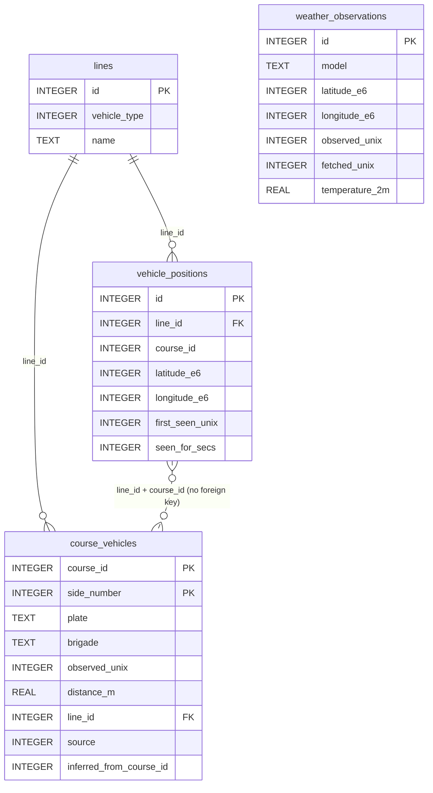

# Database

All data is stored in one SQLite file, `mpk-history.sqlite` by default (`--database`
or `MPK_DATABASE`). The code accesses it with sqlx (`src/db.rs`). Where the data comes
from is described in [data-sources.md](data-sources.md).

## Opening and migrations

- **Journal mode:** the database runs in WAL mode with `synchronous = NORMAL`. Readers
  such as `sqlite3` or `query` can work while the collector writes. The `-wal` and
  `-shm` files next to the database belong to it.
- **Connection:** the pool has one connection. The three collector loops share it, and
  each save is one transaction.
- **Migrations:** the schema is built by the SQL files in `migrations/`. They are
  compiled into the binary (`sqlx::migrate!`), and `build.rs` makes Cargo rebuild when
  a migration file changes.
- **Open modes:**

  | Command | Open mode | Runs migrations |
  |---|---|---|
  | `collect` | `CreateIfMissing` | yes, creates the file if needed |
  | `query`, `bbox` | `MustExist` | yes |
  | `backup` | `ExistingAsIs` | no, and doesn't change any settings |

  Because `query` and `bbox` run migrations, running a **newer** binary's `query`
  against a database used by an **older** running collector can change the schema
  under it. `backup` is always safe.

## Conventions

| Pattern | Meaning | Example |
|---|---|---|
| `*_e6` | Coordinate in microdegrees (degrees × 1,000,000), as an integer | `51148666` = 51.148666° |
| `*_unix` | UTC Unix time in seconds | `first_seen_unix` |
| `*_secs` | Duration in seconds | `seen_for_secs` |
| `*_m` | Distance in metres | `distance_m` |

Integers instead of floats keep rows small, and microdegrees are more precise than the
source data (see [data-sources.md](data-sources.md#response)). Enums are stored as
integers:

| Column | Values |
|---|---|
| `lines.vehicle_type` | `0` bus, `1` tram, `2` train |
| `course_vehicles.source` | `0` matched directly, `1` inferred |

## Tables



### `lines`

One row per line, keyed on vehicle type and name. It is filled by the collector the
first time a line shows up in the positions feed, so it can grow when MPK adds lines.

| Column | Meaning |
|---|---|
| `id` | Line ID used by the other tables |
| `vehicle_type` | `0` bus, `1` tram, `2` train |
| `name` | Lowercase line name, e.g. `18`, `a`, `d` |

Indexes: `UNIQUE (vehicle_type, name)`, and `lines_name (name)` for lookups by name
alone.

### `vehicle_positions`

The main table. **One row means: a vehicle of this line and course was at this
position from `first_seen_unix` to `first_seen_unix + seen_for_secs`.** Rows are
written by the tracker described in
[data-sources.md](data-sources.md#from-positions-to-rows):

- A new position inserts a row with `seen_for_secs = 0`.
- Each later fetch that finds the vehicle still at that position (within
  `--min-move-meters`) sets `seen_for_secs` to the time since `first_seen_unix`.

| Column | Meaning |
|---|---|
| `id` | Row ID. It grows with insert time |
| `line_id` | References `lines.id` |
| `course_id` | Course ID from the feed (`k`), one trip of one brigade |
| `latitude_e6`, `longitude_e6` | Position where the row started |
| `first_seen_unix` | Fetch time when the vehicle was first seen at this position |
| `seen_for_secs` | How long it was seen there. Last seen = `first_seen_unix + seen_for_secs` |

Rules the rows follow:

- A row covers at most **10 minutes** (`MAX_ROW_SPAN`). A vehicle standing still
  longer gets a new row every 10 minutes.
- A row stops being extended when the vehicle is missing from a successful fetch, or
  when fetches failed for more than 3 intervals. The row stays in the table; the next
  sighting starts a new row.
- At most one fetch per second is saved. A fetch due in the same second is not made.

Index: `vehicle_positions_line_first_seen (line_id, first_seen_unix)`. There is no
index on time alone or on `course_id` alone; each would add about 25–30% to the table
size. Queries should filter by line, or join through `line_id`.

**Where was a vehicle at time T?** This is how `query` works:

1. Take the rows of the line with `first_seen_unix` between
   `T − 10 min − max age` and `T`. The 10-minute row limit guarantees that no older
   row can still cover T, so this range can use the index.
2. For each vehicle (line and course), keep the row with the latest start. Also keep
   other rows of the course that are still active at that start, for the rare case of
   two vehicles sharing a course ID.
3. Leave out of the result the vehicles last seen more than `--max-age-secs`
   (default 30) before T. Nothing in the table changes.

**Speed** (`KM/H` in `query`) is not stored. It is computed from the rows of the 60 s
before T: the sum of straight-line distances between positions, divided by the time
they cover (`src/speed.rs`).

### `course_vehicles`

Which physical vehicle drove a course. It is filled by direct matches with the open
data fleet, and by inference from neighbouring courses (see
[data-sources.md](data-sources.md#how-the-sources-are-linked)).

| Column | Meaning |
|---|---|
| `course_id` | Course ID, the same as in `vehicle_positions` |
| `side_number` | Side number (`Nr_Boczny`) |
| `plate` | Plate, uppercase without spaces, or `NULL` |
| `brigade` | Brigade code, or `NULL` |
| `observed_unix` | Time of the fleet record used. For inferred rows, copied from the source course |
| `distance_m` | Matched: distance between the fleet record and our stored position. Inferred: distance between one trip's end and the next trip's start |
| `line_id` | References `lines.id`. Together with `course_id` it finds the course's positions through the index |
| `source` | `0` matched directly, `1` inferred |
| `inferred_from_course_id` | For inferred rows, the course the vehicle was copied from. Following it gives the chain |

Rules the rows follow:

- **Key:** the primary key is `(course_id, side_number)`. A course usually has one
  row; two rows mean two vehicles shared the course ID.
- **Direct matches win:** a direct match deletes any inferred row of its course first.
  If the vehicle changed, the correction is copied down the chain.
- **Inference only fills gaps:** it only adds rows to courses that have none.
- **Missing `line_id`:** migration `0010` filled in `line_id` for existing rows. A
  collector built before `0010` that kept running after it was applied saves matches
  with `line_id = NULL`. Such rows stay in the table and still show in the SIDE,
  PLATE and BRIGADE columns of `query`, but inference and `query --plate` don't use
  them.

Indexes: the primary key (`course_id` first), `course_vehicles_side_number`, and
`course_vehicles_plate`.

### `weather_observations`

One row per grid point per 15-minute weather value.

| Column | Meaning |
|---|---|
| `model` | Weather model, e.g. `icon_d2` |
| `latitude_e6`, `longitude_e6` | Grid point |
| `observed_unix` | Start of the 15-minute step the values belong to |
| `fetched_unix` | When we downloaded it |
| `temperature_2m` … `wind_gusts_10m` | Values in Open-Meteo default units (°C, %, mm, cm, WMO code, %, hPa, km/h, °). `NULL` when the API sent `null` |

Index: `UNIQUE (model, observed_unix, latitude_e6, longitude_e6)`. It also stops the
same value from being stored twice after a restart (`INSERT OR IGNORE`). Queries by
time should include `model = '…'` to use this index.

## Indexes and queries

| Query | Index used |
|---|---|
| `query --line`, fleet matching, inference summaries, speed | `vehicle_positions_line_first_seen` |
| `query --plate` | `course_vehicles_plate`, then `vehicle_positions_line_first_seen` |
| SIDE / PLATE / BRIGADE columns | `course_vehicles` primary key |
| Tracker updates | `vehicle_positions` primary key |
| Line lookup by name | `lines_name` |
| `bbox` | none, it reads the whole table. This is fine for an occasional command |

## Size

Measured on compacted data: a `vehicle_positions` row takes about 47 bytes, of which
about 15 are in the index. The other tables are small in comparison. How many rows per
day you get depends on the interval, the time of day and `--min-move-meters`. The 2 m
default stores about 22% fewer rows than storing every change. To see the real growth:

```sql
SELECT date(first_seen_unix, 'unixepoch', 'localtime') AS day, COUNT(*) AS rows
FROM vehicle_positions
GROUP BY day;
```

## Migrations

| Migration | Change | Rebuilds a table |
|---|---|---|
| `0001_init` | First schema: `snapshots` and `positions` | |
| `0002_position_intervals` | One row per position with first and last seen time | yes |
| `0003_integer_coordinates` | Coordinates as `*_e6` integers | yes |
| `0004_drop_invalid_coordinates` | Delete positions outside ±90° / ±180° | |
| `0005_compact_types_and_times` | Vehicle type as integer, times in seconds, `seen_for_secs` | yes |
| `0006_drop_null_island` | Delete positions at `0, 0` | |
| `0007_weather_observations` | Weather table | |
| `0008_lines_table` | `lines` table, `line_id` instead of line name and type | yes |
| `0009_course_vehicles` | Fleet matches table | |
| `0010_course_vehicles_plate` | Plate index, `line_id` in `course_vehicles` | |
| `0011_lines_name_index` | Index on line name | |
| `0012_inferred_course_vehicles` | `source` and `inferred_from_course_id` | |

Before starting a new binary whose new migrations **rebuild a table**, stop the
running collector. An old collector writing into a rebuilt table fails on every fetch.
The other migrations are safe to apply while it runs.

## Backup and restore

`mpk-history backup <file>` writes a consistent, compacted copy with `VACUUM INTO`,
even while the collector writes. It refuses to overwrite an existing file. The copy is
a plain single file, not in WAL mode.

To restore: stop the collector, replace `mpk-history.sqlite` with the backup, and
delete any leftover `mpk-history.sqlite-wal` and `-shm`. A leftover `-wal` would be
replayed into the restored file and damage it.

## Example queries

Open the live database read-only, so it's safe while collecting:

```sh
sqlite3 -header -column 'file:mpk-history.sqlite?mode=ro'
```

### Lines

```sql
SELECT id,
       name,
       CASE vehicle_type WHEN 0 THEN 'bus' WHEN 1 THEN 'tram' WHEN 2 THEN 'train' END AS type
FROM lines
ORDER BY vehicle_type, name;
```

### Courses of a line

```sql
SELECT p.course_id,
       datetime(MIN(p.first_seen_unix), 'unixepoch', 'localtime') AS first_seen,
       datetime(MAX(p.first_seen_unix + p.seen_for_secs), 'unixepoch', 'localtime') AS last_seen,
       COUNT(*) AS positions
FROM vehicle_positions p
JOIN lines l ON l.id = p.line_id
WHERE l.name = '18'
GROUP BY p.course_id
ORDER BY first_seen;
```

### Trips of one vehicle

```sql
SELECT cv.course_id,
       l.name AS line,
       cv.brigade,
       CASE cv.source WHEN 0 THEN 'matched' ELSE 'inferred' END AS source,
       datetime(MIN(p.first_seen_unix), 'unixepoch', 'localtime') AS trip_start,
       datetime(MAX(p.first_seen_unix + p.seen_for_secs), 'unixepoch', 'localtime') AS trip_end
FROM course_vehicles cv
JOIN lines l ON l.id = cv.line_id
JOIN vehicle_positions p ON p.line_id = cv.line_id AND p.course_id = cv.course_id
WHERE cv.side_number = 7349
GROUP BY cv.course_id
ORDER BY trip_start;
```

Join `vehicle_positions` on **both** `line_id` and `course_id`. Joining on `course_id`
alone can't use an index and reads the whole table.

### Weather at a vehicle's position

The latest stored weather value at or before the vehicle's time, from the nearest grid
point. `0.395` is cos²(51.1°); it makes east–west microdegrees count the same distance
as north–south ones.

```sql
WITH v AS (
    SELECT p.latitude_e6 AS lat, p.longitude_e6 AS lon, p.first_seen_unix AS t
    FROM vehicle_positions p
    JOIN lines l ON l.id = p.line_id
    WHERE l.name = '122' AND p.course_id = 29114066
    ORDER BY p.first_seen_unix DESC
    LIMIT 1
)
SELECT datetime(w.observed_unix, 'unixepoch', 'localtime') AS observed,
       w.temperature_2m, w.precipitation, w.weather_code, w.wind_speed_10m
FROM weather_observations w, v
WHERE w.model = 'icon_d2'
  AND w.observed_unix = (
      SELECT MAX(observed_unix) FROM weather_observations
      WHERE model = 'icon_d2' AND observed_unix <= v.t
  )
ORDER BY (w.latitude_e6 - v.lat) * (w.latitude_e6 - v.lat)
       + (w.longitude_e6 - v.lon) * (w.longitude_e6 - v.lon) * 0.395
LIMIT 1;
```
